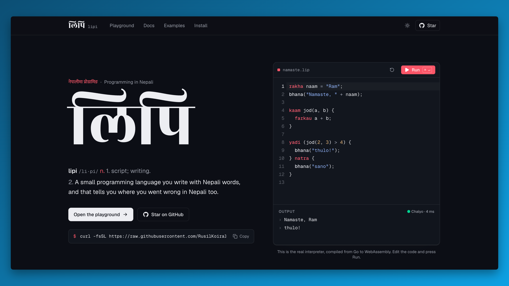

# Lipi

Lipi (लिपि, "script") is a small programming language with Nepali keywords. You write `rakha` instead of `let`, `yadi` instead of `if`, `kaam` instead of `function`, and when something breaks, the error message is in Nepali too.

It's a tree-walking interpreter written in Go, built by working through Thorsten Ball's [Writing an Interpreter in Go](https://interpreterbook.com).



```text
rakha naam = "Ram";
bhana("Namaste, " + naam);

kaam jod(a, b) {
  farkau a + b;
}

yadi (jod(2, 3) > 4) {
  bhana("thulo!");
} natra {
  bhana("sano");
}
```

```text
$ lipi namaste.lip
Namaste, Ram
thulo!
```

## Install

### macOS and Linux

```sh
curl -fsSL https://raw.githubusercontent.com/RusilKoirala/lipi/master/install.sh | sh
```

This downloads the right binary for your machine from the latest release, verifies its checksum, puts it in `~/.lipi/bin` and adds that folder to your PATH. Run it again to update. You can [read the script](install.sh) first if you'd rather.

### Windows

Download [`lipi-setup.exe`](https://github.com/RusilKoirala/lipi/releases/latest/download/lipi-setup.exe) from the latest release and run it. It installs for your user only (no admin prompt) and adds `lipi` to your PATH. Uninstall it from Settings > Apps like any other program.

Windows SmartScreen may warn about it because the installer isn't code-signed yet. Click "More info", then "Run anyway".

### With Go

Needs Go 1.26 or newer.

```sh
go install github.com/rusilkoirala/lipi@latest
```

Open a new terminal afterwards and check that it worked:

```sh
lipi --version
```

## Usage

```sh
lipi program.lip
```

Lipi files use the `.lip` extension. There's an example in [`examples/`](examples).

## The language

| Lipi | Meaning | Example |
| --- | --- | --- |
| `rakha` | let | `rakha umer = 21;` |
| `kaam` | function | `kaam jod(a, b) { ... }` |
| `farkau` | return | `farkau a + b;` |
| `yadi` / `natra` | if / else | `yadi (umer > 17) { ... } natra { ... }` |
| `sahi` / `galat` | true / false | `rakha thik = sahi;` |
| `bhana` | print | `bhana("Namaste", naam);` |
| `lambai` | length of a string | `lambai("Pokhara")` |

Values are integers, strings, booleans and functions. Strings can contain Devanagari, and `lambai` counts characters rather than bytes. Every statement ends with `;`, except blocks that end in `}`.

Functions are first-class, so closures and recursion work:

```text
kaam gunak(x) {
  farkau kaam(y) { farkau x * y; };
}

rakha tebar = gunak(3);
bhana(tebar(7));        // 21

kaam fib(n) {
  yadi (n < 2) { farkau n; }
  farkau fib(n - 1) + fib(n - 2);
}

bhana(fib(20));         // 6765
```

There are no loops or arrays yet. See [What's missing](#whats-missing).

## Errors

Every error starts with `Galti:` ("mistake"), gives the line number and says what went wrong in Nepali:

```text
Galti: line 3 ma semicolon birsiyo
Galti: line 7 ma 'umer' bhanne naam bhetiyena
Galti: line 2 ma sankhya ra string jodna mildaina
```

Those read as "you forgot a semicolon on line 3", "no name called 'umer' was found on line 7" and "a number and a string can't be added on line 2". The full list is in the [Galti reference](website/src/content/docs/errors.md).

## How it works

Source text goes through the same three stages as in the book:

1. **Lexer** (`lexer/`) turns text into tokens and records the line of each one, which is what lets errors point at a line.
2. **Parser** (`parser/`) is a Pratt parser that builds an AST (`ast/`). Operator precedence comes from binding power rather than grammar rules, and function calls are just the highest-precedence infix operator.
3. **Evaluator** (`evaluator/`) walks the tree. Variables live in environments (`object/`) that point to their enclosing scope, which is how closures keep their variables.

The keyword table is in `token/token.go`, so changing a keyword is a one-line edit.

The same interpreter is compiled to WebAssembly (`wasm/`) for the online playground, so the browser runs exactly the code the CLI does.

```text
token/       token types and the Nepali keyword table
lexer/       source text -> tokens
ast/         syntax tree nodes
parser/      tokens -> AST
object/      runtime values and environments
evaluator/   AST -> result, plus the built-ins
wasm/        WebAssembly bridge for the playground
main.go      the lipi command
website/     the website, docs and playground (Astro)
installer/   Windows setup wizard (Inno Setup)
install.sh   macOS and Linux installer
```

## Development

Run the tests:

```sh
go test ./...
```

Build and run locally:

```sh
go build -o lipi .
./lipi examples/namaste.lip
```

### Website

The site lives in `website/` and is built with Astro, Tailwind and shadcn/ui. The playground uses CodeMirror and loads `website/public/lipi.wasm`.

```sh
cd website
npm install
npm run wasm   # rebuild lipi.wasm after changing the interpreter
npm run dev
```

### Releases

Pushing a version tag runs [`.github/workflows/release.yml`](.github/workflows/release.yml):

```sh
git tag v0.1.0
git push origin v0.1.0
```

It builds binaries for macOS, Linux and Windows, builds the Windows installer and tests it on a real Windows runner (install, run, uninstall, check PATH), publishes the release with checksums, and then installs the release with `install.sh` on Linux and macOS to check that path too.

## What's missing

Planned, roughly in this order:

- a REPL (`lipi` with no file)
- loops (`jabasamma`, "as long as")
- arrays
- `<=` and `>=`
- `natra yadi` (else-if without nesting)
- hash maps and string escapes like `\n`

Issues and pull requests are welcome.

## Credits

The interpreter's design follows [Writing an Interpreter in Go](https://interpreterbook.com) by Thorsten Ball. The Nepali keywords, error messages, line tracking, installers and website are Lipi's own additions.
