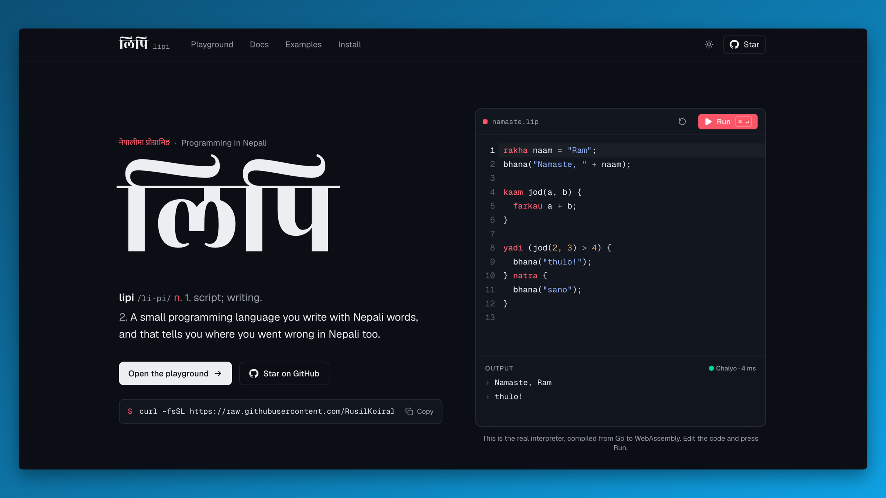

# Lipi

Lipi (लिपि, "script") is a small programming language with Nepali keywords :). You write `rakha` instead of `let`, `yadi` instead of `if`, `kaam` instead of `function`, and when you mess up, the error yells at you in Nepali too (yes `Galti:` is real).

It is a tree-walking interpreter written in Go, and I built it by following Thorsten Ball's [Writing an Interpreter in Go](https://interpreterbook.com).



## Motivation

I really wanted to know HOW DOES A PROGRAMMING LANGUAGE WORK? You type some text, and somehow the computer runs it?? The only way to really get it is to make one yourself. So with this mindset I started making this project!

And if I am making a language anyway, why not make it Nepali :D

## What I learned

This should be at a blog but sorry, readme again :) . A language is not one big magic thing, it's small steps passing work to each other. Text becomes tokens, tokens become a tree, and the tree gets run. Once I saw that, it stopped feeling like magic.

The Pratt parser was the coolest part. Operator precedence is just numbers, and a function call is just the strongest operator (WHAT). Closures also made sense when I saw they are just a function holding on to the scope it was made in.

## What this project does

- Variables, integers, strings and booleans.
- Functions with closures and recursion.
- `yadi` / `natra` conditions.
- Errors in Nepali WITH the line number.
- Strings can have Devanagari, and `lambai` counts characters, not bytes.
- A playground in the browser that runs the same interpreter (Go compiled to WebAssembly).
- Installers for macOS, Linux and Windows.

## Galti (the errors)

Every error starts with `Galti:` ("mistake"), gives the line number and tells you what went wrong in Nepali:

```text
Galti: line 3 ma semicolon birsiyo
```

## How it flows

1. **Lexer** (`lexer/`) turns your text into tokens and remembers the line of each one (this is how errors know the line!).
2. **Parser** (`parser/`) is a Pratt parser that turns tokens into a tree (`ast/`).
3. **Evaluator** (`evaluator/`) walks the tree and runs it. Variables live in environments (`object/`) that point to the scope around them, and that is how closures keep their variables.

The keywords are in `token/token.go`, so changing a keyword in the interpreter is a one-line edit.

The same interpreter gets compiled to WebAssembly (`wasm/`) for the playground, so the browser runs the same code as the CLI.


## AI USAGE NOTE

I used AI help for writing test functions, and for explanations while I was learning. AI also helped me to make the website for it and WASM play ground 

Readme, many parts of lexer, tokens and parser was written by me

## Credits

The interpreter's design follows [Writing an Interpreter in Go](https://interpreterbook.com) by Thorsten Ball. The Nepali keywords, error messages, line tracking, installers and website are Lipi's own additions.

## Thank you so much for reading this readme, I really appreciate it :D
